

  

  <b>Hi, I'm Moki 🍓</b> 
  I design and build interfaces, websites and original digital assets: 
  3D in the browser, animated UI, pixel art and small apps people actually use.

  

 

### 🍓 Things I made

  <a href="https://github.com/mokiofficiial/chess3D">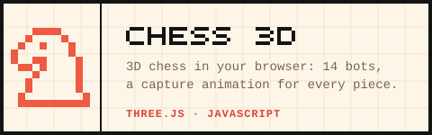</a>
  <a href="https://github.com/mokiofficiial/pixel-icons">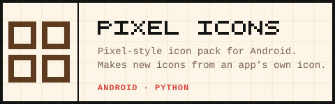</a>
  <a href="https://github.com/mokiofficiial/moki-ui">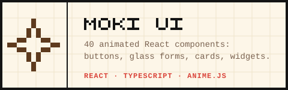</a>
  <a href="https://github.com/mokiofficiial/meow-music-site">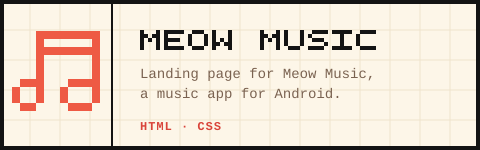</a>
  <a href="https://github.com/mokiofficiial/student-notes-website">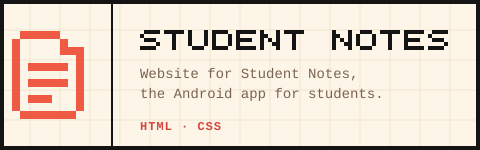</a>

  ♟️ <a href="https://chess3d-kappa.vercel.app"><b>Play Chess 3D</b></a>

 

### 🧰 What I build with

  
  
  
  
  
  
   
  
  
  
  
  

 

### 📊 Moki stats

  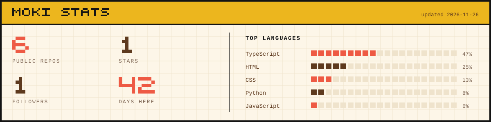

  

 

### 💌 Say hi

  <a href="https://www.linkedin.com/in/moki-officiial-570076444">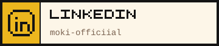</a>
  <a href="https://www.instagram.com/moki._.officials/">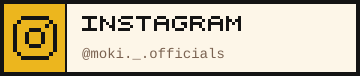</a>
  <a href="https://www.threads.com/@moki._.officials">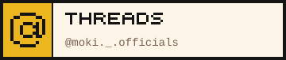</a>

 

  

